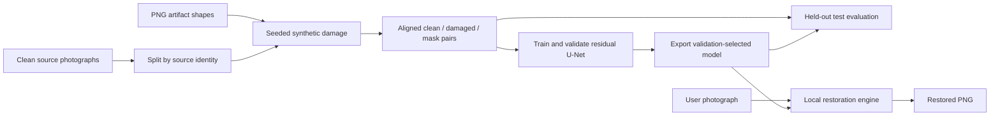
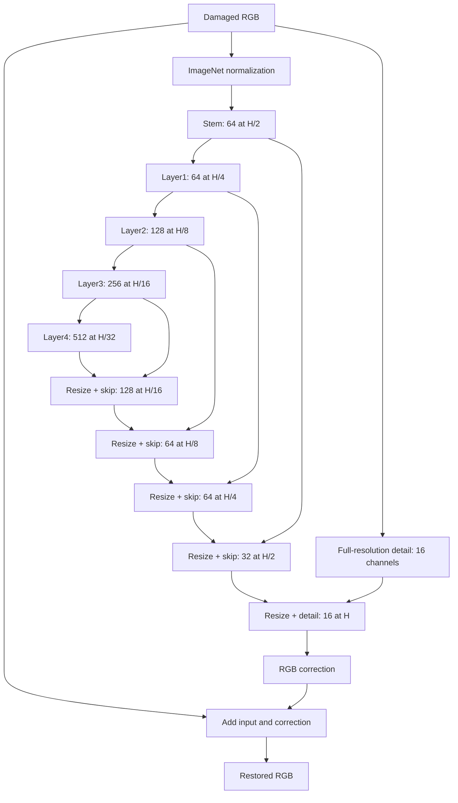

# Image Restoration Project: Complete Technical Report

**Report date:** 23 October 2026  
**Workspace:** `D:\MV`  
**Current model:** `checkpoints/final_restoration.pt`  
**Current architecture:** residual ResNet34 U-Net, checkpoint identifier `restoration_v2`  
**Current status:** final training, export, full synthetic test evaluation, and sample generation completed.

This report describes the implementation and saved evidence present in the local project. It replaces the report dated 19 October, which predates both completed v2 training and the final continuation. The earlier report and all other superseded documentation are preserved in [old/2026-10-23](old/2026-10-23/ARCHIVE_GUIDE.md).

The report was prepared by reading the code, configuration, dataset metadata, training histories, completion status, evaluation records, and sample manifests. Charts and descriptive statistics were regenerated from those saved records. No new training, model inference, full dataset preflight, or regression suite was run for this documentation task. Historical checks are identified as historical evidence.

## Contents

1. [Project outcome and essential facts](#1-project-outcome-and-essential-facts)
2. [Problem definition and implemented scope](#2-problem-definition-and-implemented-scope)
3. [Project evolution and reference material](#3-project-evolution-and-reference-material)
4. [Current repository structure](#4-current-repository-structure)
5. [Source photographs and split design](#5-source-photographs-and-split-design)
6. [Synthetic damage assets and generation](#6-synthetic-damage-assets-and-generation)
7. [Dataset layout, metadata, and tensor contracts](#7-dataset-layout-metadata-and-tensor-contracts)
8. [Dataset preparation and audit evidence](#8-dataset-preparation-and-audit-evidence)
9. [Current restoration architecture](#9-current-restoration-architecture)
10. [Loss functions and mask supervision](#10-loss-functions-and-mask-supervision)
11. [Parent v2 training](#11-parent-v2-training)
12. [Final continuation training](#12-final-continuation-training)
13. [Checkpoints, selection, and resume behavior](#13-checkpoints-selection-and-resume-behavior)
14. [Evaluation protocol and metric definitions](#14-evaluation-protocol-and-metric-definitions)
15. [Final quantitative results](#15-final-quantitative-results)
16. [Hair restoration and the effect of the final phase](#16-hair-restoration-and-the-effect-of-the-final-phase)
17. [Per-image outcomes and difficult cases](#17-per-image-outcomes-and-difficult-cases)
18. [Qualitative evidence and how to read it](#18-qualitative-evidence-and-how-to-read-it)
19. [Historical architecture and experiments](#19-historical-architecture-and-experiments)
20. [Restoring a user photograph](#20-restoring-a-user-photograph)
21. [Generating damage on a user photograph](#21-generating-damage-on-a-user-photograph)
22. [Environment, dependencies, and reproducibility](#22-environment-dependencies-and-reproducibility)
23. [Operational commands](#23-operational-commands)
24. [Existing tests and recorded checks](#24-existing-tests-and-recorded-checks)
25. [Limitations and interpretation](#25-limitations-and-interpretation)
26. [Archive decisions and recovery](#26-archive-decisions-and-recovery)
27. [Code responsibilities and dependency map](#27-code-responsibilities-and-dependency-map)
28. [Recommended future experiments](#28-recommended-future-experiments)
29. [Evidence index and handoff](#29-evidence-index-and-handoff)

## 1. Project outcome and essential facts

The project trains a neural network to remove synthetic film defects from RGB images. A damaged RGB photograph enters the model; a restored RGB image leaves it. Clean targets and damage masks are available during training. A user does not supply a mask during restoration.

The final exported model achieved the following saved test results:

| Measure | Damaged input | Previous trained v2 model | Final exported model |
|---|---:|---:|---:|
| Mean per-pair PSNR, dB | 25.067406 | 34.388137 | **38.501499** |
| Mean per-pair SSIM | 0.908485 | 0.973866 | **0.985564** |
| Mean per-pair MAE | 0.02488804 | 0.00508835 | **0.00345525** |
| Mean per-pair MSE | 0.01252233 | 0.00103585 | **0.00058516** |
| Test pairs | 1,654 | 1,654 | 1,654 |

The final model improves mean PSNR by **13.4341 dB** over damaged inputs and **4.1134 dB** over the previous v2 model on the same saved benchmark. Relative to the damaged inputs, mean MAE falls by approximately **86.12%** and mean MSE by **95.33%**. Both long-hair-only and short-hair-only groups improve in the final model, addressing a failure of the previous checkpoint. These are aggregate results; some individual images worsen, as documented later.

| Fact | Value |
|---|---|
| Selected checkpoint epoch | Global epoch 119; final continuation epoch 84 |
| Completed training epochs | 35 parent epochs + 85 continuation epochs = 120 |
| Selection basis | Lowest final validation objective, including damage-region loss |
| Training pairs / validation pairs / test pairs | 7,714 / 1,654 / 1,654 |
| Distinct training / validation / test sources | 3,857 / 827 / 827 |
| Prepared pair resolution | 256 × 256 RGB |
| Damage categories | Nine |
| Training damage severities | Light and medium |
| Recorded training/evaluation accelerator | NVIDIA GeForce RTX 4050 Laptop GPU / CUDA |
| Final export size | 89,199,562 bytes, approximately 85.07 MiB |
| Network required for final inference | No, with the local export and installed packages |

Primary evidence: [final test metrics](results/final_model/metrics.json), [completion status](runs/restoration_final/status.json), [final training history](runs/restoration_final/history.csv), and [previous v2 test metrics](old/2026-10-23/results/evaluation_v2/best_metrics.json).

## 2. Problem definition and implemented scope

Photographs with localized scratches, dust, stains, and hair occlusions contain both useful scene content and damaged regions. The restoration task is to infer a plausible clean RGB image while limiting changes to content that was already usable. This project studies that problem using paired synthetic damage, which provides an exact clean target for each corrupted image.

The source scene labels are **buildings** and **street**. They identify the content used to train and analyze restoration. They are not classes predicted by a classification head. The network's output is a three-channel image, not a class label, bounding box, or segmentation mask.

The implemented system includes source splitting, artifact synthesis, aligned pair preparation, transfer learning, reconstruction and perceptual objectives, region supervision, training logs, checkpoint export, quantitative evaluation, qualitative comparisons, and local command-line tools. The current active application is a local Python workflow with Windows batch launchers. Browser demonstration artifacts belong to the archive.

The model operates on RGB input. Grayscale files are converted to RGB internally and converted back to grayscale after inference. That convenience does not make the project a colorization system. No current training objective predicts missing color channels. The current training code also does not contain an adversarial discriminator or GAN objective.



## 3. Project evolution and reference material

The workspace contains three distinct generations of work. Their scores and assumptions must be kept associated with their own datasets and implementations.

| Generation | Core files | Data | Outcome |
|---|---|---|---|
| Historical experiments | Archived `train.py`, `losses.py`; shared `unet.py` | Archived `restoration_dataset/` | L1, perceptual, and perceptual+SSIM experiment weights and text results |
| Parent v2 | `restoration_v2.py`, `losses_v2.py`, `train_v2.py` | Current `restoration_dataset_v2/` | 35 epochs; 34.3881 dB / 0.973866 test SSIM; hair-only failure remained |
| Final continuation | `train_final.py`, `MaskedRestorationLoss` | Same current v2 dataset | 85 further epochs; export selected epoch 119; 38.5015 dB / 0.985564 SSIM |

The original brief and early phase documents focused on seven bright damage categories. The implemented v2 configuration extends the set with `hair` and `hair-short`, using dark polarity for both. The current code, configurations, prepared data, and test records establish the nine-category implementation. Early descriptions that exclude hair describe an earlier scope.

The existing project identifies two reference repositories: FilmDamageSimulator for synthetic artifact ideas/assets and DustScratchRemoval for a ResNet U-Net restoration and perceptual-loss approach. Their local snapshots are preserved under `old/2026-10-23/external/`. The active code uses local adaptations, not runtime imports from those repository trees. The Perlin placement function in `damage_adapter.py` is explicitly described as adapted from FilmDamageSimulator, and `restoration_v2.py` describes its derivation from this project's ResNet U-Net / DustScratchRemoval approach.

The historical `model2.py` is a notebook-style export containing older framework imports and notebook syntax. It is reference material, not the current executable training entry point. Its imports do not establish that those methods were used by the final model.

Dates from the retained documentation and completion records place v2 preparation on 15 October, the parent run across 21–22 October, and final completion on 22 October 2026. This report and the archival cleanup are dated 23 October.

## 4. Current repository structure

```text
D:\MV\
  README.md                         Current quick-start guide
  PROJECT_REPORT.md                 This detailed report
  requirements-v2.txt               Recorded environment package versions
  restore_image.py / .bat           Restore user photographs
  damage_image.py / .bat            Generate synthetic damage
  configs/
    restoration_v2.yaml             Preparation and parent training configuration
    restoration_final.yaml          Final continuation configuration
  src/
    pipeline_config.py              Shared configuration loader and validation
    dataset/
      damage_adapter.py             Artifact-mask placement and bright/dark damage
      prepare_v2.py                 Deterministic aligned lossless pair generation
    model/
      restoration_v2.py             Current architecture and shared checkpoint loader
      losses_v2.py                  L1, Gaussian SSIM, VGG, damage-region loss
      dataset_v2.py                 Training pairs with masks and augmentation
      train_v2.py                   Parent trainer and shared training utilities
      train_final.py                Final weighted-sampling continuation/export
      run_training_offline.py       Offline parent launcher and Windows sleep control
      preflight_v2.py               Pair audit and forward/loss readiness checks
      evaluate.py                   Full-image test metrics and JSON provenance
      visualize_samples.py          Seeded four-panel comparison export
      inference.py                  Local restoration engine and tiled inference
      predict.py                    Compatibility entry point for restore_image.py
      dataset.py                    Shared two-image loader used by evaluation
      unet.py                       Historical architecture kept for checkpoint loading
    reporting/
      build_report_figures.py       Charts/statistics from saved records only
  data/clean_splits/                Retained split source JPEGs
  damage dataset/                   Retained artifact PNG collection
  restoration_dataset_v2/           Current prepared clean/damaged/mask PNGs
  checkpoints/final_restoration.pt  Final inference export
  runs/
    restoration_v2/                 Parent checkpoints, config, history, previews
    restoration_final/              Final checkpoints, config, history, status, previews
    restoration_final.stdout.log    Completed final training text log
    restoration_final.stderr.log    Completed final progress/error stream
  results/
    final_model/                    Full test metrics, logs, and 20 samples
    project_report/                 New charts and descriptive statistics
  tests/                            Existing regression checks
  old/
    README.md                       Archive index
    2026-10-23/                     Earlier material, move manifest, recovery information
```

Two filenames can appear historical while still being necessary. `train_v2.py` supplies functions imported by `train_final.py`. `dataset.py` supplies the paired image loader used by the current evaluator and visualization tool. Likewise, the checkpoint loader retains a fallback to `unet.py` for historical raw state dictionaries. These files remain outside the archive because they have active references.

The exported checkpoint and datasets are local artifacts. `.gitignore` excludes checkpoints, prepared datasets, runs, and several large source/reference directories. Their presence in this workspace does not imply they are available in a fresh source checkout.

## 5. Source photographs and split design

The selected clean source collection contains **5,511 images**: 2,628 buildings and 2,883 street photographs. The archived splitter pools the selected classes from the Intel collection's original train and test directories, then makes a new stratified split. Consequently, this project uses its own split rather than the original collection's published train/test division.

The split ratios are 70% training, 15% validation, and 15% test, with seed 42. Splitting happens before generating multiple corruptions of a source. The saved class counts are:

| Split | Buildings sources | Street sources | All sources | Pairs after two variants |
|---|---:|---:|---:|---:|
| Train | 1,839 | 2,018 | 3,857 | 7,714 |
| Validation | 394 | 433 | 827 | 1,654 |
| Test | 395 | 432 | 827 | 1,654 |
| Total | 2,628 | 2,883 | 5,511 | 11,022 |

The current preparation and training checks compare source IDs such as `buildings/16137.jpg` across splits and reject overlaps. All variants of one source belong to the same split. That prevents an exact source ID from appearing in both training and test through different corruptions.

The historical inspection describes the source photographs as approximately 150 × 150 RGB JPEGs. Current preparation converts each source to RGB and resizes it directly to 256 × 256 with Lanczos interpolation. This is resizing rather than a crop-based native-resolution experiment. Upscaling supplies the model's working resolution; it does not recover extra scene information absent from the original source.

The retained `data/clean_splits/` is sufficient to regenerate current pairs when the artifact assets and preparation code are also available. The larger original collection, including unused scene categories and prediction images, is archived under `old/2026-10-23/original dataset, intel image classification/`. The archived splitter depends on scikit-learn and contains historical absolute paths; it is not needed to use the current split.

Source-ID separation does not establish semantic independence or rule out near-duplicate photographs with different names. The current records do not contain a dedicated perceptual duplicate study. Artifact asset shapes are also shared across dataset splits; the benchmark therefore tests new scene sources under the same synthetic damage family.

## 6. Synthetic damage assets and generation

### 6.1 Artifact collection

The prepared dataset records the following asset counts:

| Type | PNG assets | Applied polarity | Interpretation |
|---|---:|---|---|
| `dirt` | 200 | Bright | Small irregular marks |
| `dots` | 200 | Bright | Dot-shaped defects |
| `scratches` | 200 | Bright | Elongated scratch marks |
| `smut` | 200 | Bright | Irregular dirty patches |
| `spots` | 200 | Bright | Local spot defects |
| `sprinkles` | 200 | Bright | Scattered fine marks |
| `stain` | 200 | Bright | Stain-shaped regions |
| `hair` | 4,000 | Dark | Long hair shapes |
| `hair-short` | 500 | Dark | Short hair shapes |
| Total configured assets | 5,900 | Mixed | Nine configured categories |

The active asset directory contains additional files beyond those selected by these nine configured categories; only the configured folders contribute to the current prepared dataset. `lint` is not configured.

The simulator reads transparent PNGs and uses their alpha channels as shape masks. It does not copy the asset's RGB color into the photograph. It crops each asset to its nontransparent bounds, rotates it through a random angle, rescales it, and thresholds the transformed alpha channel at greater than 127 to create binary damage support.

### 6.2 Placement and severity

Perlin noise provides a spatial probability field for placement. Coordinates are sampled from that distribution, allowing clustered or uneven positions. The adapter treats target size as `(height, width)` and interprets sampled coordinates as row and column, which matters for nonsquare user photographs.

Artifact counts vary by family:

| Family | Base count before severity scaling |
|---|---|
| Dots and sprinkles | Random integer from 5 to 15 |
| Scratches and both hair types | Random integer from 1 to 3, with at least one placed |
| Other types | Random integer from 2 to 6 |

The count multipliers are 0.5 for light, 1 for medium, and 2 for heavy damage. Conversion to integers and canvas cropping mean visible coverage is not a fixed fraction of the image. Rotated shapes can extend beyond the boundaries and are cropped to the valid canvas.

Most artifact shapes use a random scale between 0.1 and 0.5. Scratches use 0.5–1.2, long hair 0.35–0.75, and short hair 0.25–0.6, relative to each cropped asset. These scale rules are in the current adapter.

### 6.3 Pixel modification

On disk, the mask `M` is 255 for clean pixels and 0 for damaged pixels. Let `C` be an RGB clean/current image in the 0–255 range, `s` the selected strength, and `p` equal +1 for bright damage or −1 for dark damage. An application computes:

```text
D = uint8(clip(C + p × s × 255 × (1 − M/255), 0, 255))
```

Configured strength intervals are 0.3–0.5 for light, 0.5–0.7 for medium, and 0.7–0.9 for heavy. Current dataset preparation randomly chooses only light or medium. Heavy generation is implemented in the photo utility but has no corresponding final benchmark in this workspace.

For mixed damage, selected types are applied in sequence to the progressively modified image. Masks are combined using the pixelwise minimum so any damaged pixel remains black in the union. Overlapping bright/dark applications can interact through clipping or cancellation. The mask identifies intended artifact support; it does not mean every marked pixel must have a unique final change after overlapping applications.

### 6.4 Variant construction and deterministic seeds

Each source receives two variants. The first selects one category from a rotating sequence of configured types. The second selects an anchor type plus one or two additional distinct types, producing two- or three-type mixtures. The rotating anchor balances single-category coverage across sources.

Each variant's seed is derived from SHA-256 of the global seed, source ID, and variant index. Python and NumPy are seeded before generating it. This makes a particular source/variant independent of process completion order. It does not promise bitwise reproducibility after changing library versions, asset files, preparation code, source files, or configuration.

For each selected type, preparation retries up to 40 placements until at least 16 pixels change compared with the preceding image. Failure stops generation. These checks avoid silently accepting an empty or invisible damage application. Before saving, preparation verifies that all pixels outside the union mask equal the clean array exactly.

Implementation: [damage_adapter.py](src/dataset/damage_adapter.py) and [prepare_v2.py](src/dataset/prepare_v2.py).

## 7. Dataset layout, metadata, and tensor contracts

Each split is organized by scene class:

```text
restoration_dataset_v2/
  prepared.json
  metadata/
    train.json
    val.json
    test.json
  previews/
    dirt.png ... hair.png ... hair-short.png
  train/                         # val/ and test/ have the same organization
    buildings/
      clean/16137.png
      damaged/16137_v01.png
      damaged/16137_v02.png
      masks/16137_v01_mask.png
      masks/16137_v02_mask.png
    street/
      clean/
      damaged/
      masks/
```

The filenames above illustrate the naming convention rather than assigning that particular source to the training split. Actual split membership is defined by metadata. One clean PNG is stored per source, while each variant has its own damaged PNG and mask PNG. All are generated from the same resized clean array, avoiding independent JPEG encoding differences between the target and damaged copy.

A metadata row contains:

| Field | Meaning |
|---|---|
| `source_image` | Class-qualified original filename |
| `clean_image` | Root-relative path to clean PNG |
| `damaged_image` | Root-relative path to variant PNG |
| `mask` | Root-relative path to binary PNG mask |
| `split`, `class` | Source partition and scene category |
| `damage_types` | Ordered list of selected artifact names |
| `severity`, `strength` | Count/intensity category and sampled intensity |
| `polarity` | Per-type bright/dark mapping |
| `seed` | Stable source/variant seed |
| `image_size` | Width and height, currently `[256, 256]` |
| `variant` | `v01` or `v02` |
| `damage_fraction` | Fraction of pixels black in the union mask |

The training loader returns `(damaged, clean, damage)` tensors. RGB tensors are float32 with shape `3 × H × W`, scaled to [0,1]. The mask tensor is `1 × H × W`, with **1 = damage** and **0 = clean**. This reverses the on-disk black/white convention numerically so multiplication selects damaged pixels directly.

During training, a synchronized horizontal flip occurs with probability 0.5. Clean, damaged, and mask tensors are all flipped together. Clean identity examples replace the damaged image with the clean target and set the mask to zero. The parent run uses a 10% identity probability; the final continuation uses 5%. Validation does neither augmentation nor identity replacement.

The training loader checks shape alignment. It returns masks for loss/diagnostic use; the network receives only the damaged RGB tensor. The shared `RestorationDataset` used by evaluation returns a two-item damaged/clean pair without masks, which is sufficient for full-image metrics.

## 8. Dataset preparation and audit evidence

The preparation command creates all split directories, clean/damaged/mask files, metadata, and validation previews. It refuses to use an existing nonempty output directory. The readiness file `prepared.json` is written only after successful generation of all requested splits.

The dataset ID is:

```text
febd3aba427524ee980dee311c41680da4ad13b9e600da802d8b03c67fd8e796
```

The preparation fingerprint incorporates configuration, source identities and content hashes, the preparation and adapter source bytes, and selected asset names and content hashes. The saved ID is shared by the prepared data and trained checkpoints. Changing code or content can produce a different ID; preserving a copy of `prepared.json` alone does not make changed data equivalent.

The historical full preparation audit checked all 11,022 saved pairs. It checked PNG format, 256 × 256 dimensions, channel counts, binary mask values, nonempty damage, correct metadata coverage, no repeated damaged path within a split, source-ID separation, category coverage, and exact equality outside the damage mask.

| Split | Pairs audited | Minimum damage fraction | Maximum damage fraction | Outside-mask differences |
|---|---:|---:|---:|---:|
| Train | 7,714 | 0.00024414 | 0.44738770 | 0 |
| Validation | 1,654 | 0.00024414 | 0.40393066 | 0 |
| Test | 1,654 | 0.00024414 | 0.40219116 | 0 |

At 256 × 256, the minimum recorded fraction is 16 pixels. Coverage varies greatly across artifact types, which explains why full-image scores can hide poor removal of a small hair mark.

Preparation also recorded an inference-only GPU forward/loss check with batch size four, two loader workers, cached pretrained weights, and output shape `[4, 3, 256, 256]`. The identity initialization had zero maximum input/output error. The recorded peak allocated memory was approximately 467 MiB for that forward-only check; it is not a peak training-memory claim.

The separate final-training readiness record reports 12 temporary optimizer steps, discarded temporary weights, an unchanged starting checkpoint, and approximately 908 MiB peak allocated GPU memory for its small check. That is historical readiness evidence, not a long-run memory or quality benchmark.

Evidence: [prepared dataset record](restoration_dataset_v2/prepared.json), [archived full preparation report](old/2026-10-23/runs/preparation_report.json), and [archived final readiness record](old/2026-10-23/runs/final_training_readiness.json).

## 9. Current restoration architecture

### 9.1 Encoder and input normalization

`RestorationUNet` uses a torchvision ResNet34 backbone. For a new parent run, the encoder can initialize from ImageNet weights. For final continuation it loads trained restoration weights from the parent checkpoint. The classification pooling/head of ResNet is not used.

Images enter in [0,1]. The full-resolution detail branch sees those values directly. The ResNet encoder sees channelwise ImageNet normalization inside the model:

```text
mean = [0.485, 0.456, 0.406]
std  = [0.229, 0.224, 0.225]
normalized = (image − mean) / std
```

There is no requirement for callers to apply ImageNet normalization separately. Applying it outside the model would normalize the input twice and change the intended tensor contract.

### 9.2 Feature resolutions and skip connections

For a 256 × 256 input, the main tensors have these sizes:

| Component | Resolution | Channels | Role |
|---|---:|---:|---|
| Input RGB | 256 × 256 | 3 | Damaged photograph |
| Detail branch | 256 × 256 | 16 | Full-resolution local detail |
| ResNet stem | 128 × 128 | 64 | Half-resolution skip |
| Pool + layer1 | 64 × 64 | 64 | Quarter-resolution skip |
| layer2 | 32 × 32 | 128 | Eighth-resolution skip |
| layer3 | 16 × 16 | 256 | Sixteenth-resolution skip |
| layer4 | 8 × 8 | 512 | Deepest features |
| up1 | 16 × 16 | 128 | Combines deepest tensor and layer3 |
| up2 | 32 × 32 | 64 | Combines up1 and layer2 |
| up3 | 64 × 64 | 64 | Combines up2 and layer1 |
| up4 | 128 × 128 | 32 | Combines up3 and stem |
| up5 | 256 × 256 | 16 | Combines up4 and full-resolution detail |
| Correction convolution | 256 × 256 | 3 | Predicted RGB correction |
| Restored output | 256 × 256 | 3 | Input plus correction |

Each resize block first reduces the current tensor's channels with a 1 × 1 convolution, bilinearly resizes to the skip tensor's spatial size, concatenates the skip along channels, and applies a `DetailBlock`. A detail block has two 3 × 3 padded convolutions, each followed by ReLU. The decoder does not use BatchNorm or transposed convolution.



### 9.3 Residual output and BatchNorm behavior

The final correction convolution is zero-initialized. A newly created model therefore starts as the identity mapping: output equals the damaged input. Training learns a correction rather than rebuilding every pixel from scratch. The output is not passed through sigmoid.

Optimization uses the raw residual output without clamping. Image metrics and saved images clamp to [0,1]. This keeps optimization gradients available when the raw prediction briefly exceeds the output range.

Encoder BatchNorm layers remain in evaluation mode so their running statistics do not drift with small batches. During encoder fine-tuning, affine parameters can still learn. During the parent's warmup, the encoder's parameters are frozen as well. There is no BatchNorm in the decoder.

The checkpoint identifier remains `restoration_v2` for the final model because the final phase changes training objectives and sampling rather than network topology. A filename containing “final” does not imply a new incompatible architecture.

Implementation: [restoration_v2.py](src/model/restoration_v2.py).

## 10. Loss functions and mask supervision

### 10.1 Pixel reconstruction

The base pixel objective is mean absolute error over RGB pixels:

```text
L_pixel = mean(|prediction − clean|)
```

It penalizes errors across the full image, including locations outside synthetic damage. It helps retain color and content, but a tiny damaged region contributes relatively little to a full-image average.

### 10.2 Structural objective

The current differentiable SSIM implementation uses an 11 × 11 Gaussian window, standard deviation 1.5, constants `0.01²` and `0.03²`, RGB grouped convolution, and valid-window statistics. Computation is promoted to float32 under mixed precision. The structural term is:

```text
L_structural = 1 − mean(SSIM(prediction, clean))
```

The parent reconstruction objective is `L_pixel + 0.2 × L_structural`.

### 10.3 VGG feature objective

The current feature loss uses pretrained frozen VGG16 features through layer index 15. It compares activations at indices 3, 8, and 15, corresponding to relu1_2, relu2_2, and relu3_3. Both prediction and target are ImageNet-normalized before VGG. The target branch has no gradient tracking; gradients from the prediction branch reach the restoration model.

The feature term averages L1 feature distances across these three layers. The current loss does not include a Gram-matrix style term. Its full coefficient is 0.02. In parent refinement, the training coefficient ramps to that value over five epochs; validation uses the full value for consistent stage scoring. The final continuation uses the full 0.02 coefficient throughout.

### 10.4 Damage-region objective

The final continuation adds a region-normalized MAE. For each image, it sums absolute RGB error inside the binary training mask and divides by the number of masked pixels times three channels. The batch loss is the average of those per-image region errors:

```text
region_error_i = sum(|prediction_i − clean_i| × damage_mask_i)
                 / max(3 × sum(damage_mask_i), 1)

L_region = mean_i(region_error_i)

L_final = L_pixel
          + 0.2 × L_structural
          + 0.02 × L_VGG
          + 0.1 × L_region
```

An empty identity mask contributes zero region error. Because normalization is done per image, a small hair mask is not automatically drowned out by another image with a large damaged patch. The full-image terms still penalize changes elsewhere.

The mask is a supervision signal during training. It is not fed to the encoder and does not require users to locate defects. At inference, the model must infer where correction is needed from RGB content alone.

The parent and final objectives are different. A parent validation loss of 0.012 and a final validation loss of 0.012 are not directly equivalent because the final value includes an additional region term. Training charts keep the final-objective panel limited to the continuation phase.

Implementation: [losses_v2.py](src/model/losses_v2.py).

## 11. Parent v2 training

The parent configuration requests up to 60 reconstruction epochs followed by up to 20 refinement epochs, with a total cap of 120. The recorded run actually completed **15 reconstruction epochs and 20 refinement epochs**, for 35 epochs total. Early stopping shortened the first stage.

| Setting | Parent value |
|---|---|
| Batch size / loader workers | 4 / 2 |
| Optimizer | AdamW |
| Weight decay | 0.00001 |
| Initial reconstruction decoder / encoder LR | 0.0002 / 0.00002 |
| Refinement decoder / encoder LR | 0.00002 / 0.000002 |
| Encoder warmup | First five reconstruction epochs |
| Scheduler | ReduceLROnPlateau, factor 0.5, patience 3 |
| Early stopping | Patience 10, minimum improvement 0.0001 |
| AMP | Enabled on CUDA |
| Gradient clipping | Norm 1.0 |
| Identity-example probability | 0.10 |
| VGG ramp | Five refinement epochs |
| Reconstruction score for overall selection | L1 + 0.2 × structural loss |

At the start of refinement, the trainer reloads the best reconstruction checkpoint and creates the refinement optimizer. In this run the reconstruction-stage best candidate remained the initial identity model, according to the retained evaluation report. The early phase stayed near the input baseline. The later phase learned useful correction of bright damage.

The parent `best.pt` is global epoch 35 / refinement epoch 20, selected by validation reconstruction score. `best_refinement.pt` is refinement epoch 19 under the minimum-improvement rule for stage selection. These filenames have different selection rules and can legitimately refer to different epochs.

The parent achieved 34.3881 dB / 0.973866 on the current test set, but its long-hair-only and short-hair-only groups slightly worsened relative to the input. Since the transition to refinement changed learning rate, optimizer state, and objective together, this history does not isolate a causal benefit from VGG alone.

Logged epoch time is 5,281.88 seconds, approximately 88.03 minutes. That sum excludes startup, initial validations, and separate evaluation. It should not be presented as exact elapsed wall time for the whole experiment.

Configuration: [restoration_v2.yaml](configs/restoration_v2.yaml). Evidence: [parent history](runs/restoration_v2/history.csv) and [archived v2 evaluation report](old/2026-10-23/phases%20info/phase7_evaluation_v2_report.md).

## 12. Final continuation training

### 12.1 Starting point and configuration

The final trainer starts from `runs/restoration_v2/best.pt`, the trained global-epoch-35 model, and continues on the same dataset. Its main changes are the region loss, extra sampling of hair-containing examples, reduced identity-example probability, and a further training budget.

| Setting | Final value |
|---|---|
| Additional epochs | 85 |
| Maximum global epoch budget | 120 |
| Batch size / loader workers | 4 / 2 |
| Optimizer | AdamW |
| Decoder / encoder LR | 0.00002 / 0.000002 |
| Weight decay | 0.00001 |
| SSIM / VGG / mask coefficients | 0.2 / 0.02 / 0.1 |
| Hair-containing sample weight | 2.0 versus 1.0 for other entries |
| Identity-example probability | 0.05 |
| Scheduler | ReduceLROnPlateau, factor 0.5, patience 4, minimum LR 1e-8 |
| Early stopping patience / minimum improvement | 20 / 0.00001 |
| Encoder | Unfrozen; BatchNorm statistics fixed |
| AMP / gradient clipping | Enabled / norm 1.0 |

WeightedRandomSampler draws `len(train_data)` samples with replacement each epoch. Any metadata entry containing either hair category receives sampling weight 2.0, including mixed examples. This changes expected frequency; it does not guarantee each source is seen exactly once per epoch or exactly double every individual entry's count.

The final trainer applies its own fixed full VGG coefficient and additional-epoch loop. Although the shared configuration contains reconstruction/refinement fields for compatibility with the configuration loader, this script does not execute the parent's two-stage schedule again. The actual continuation is the explicit 85-epoch loop in `train_final.py`.

### 12.2 Observed training and selection

The continuation completed global epochs 36 through 120. It selected **global epoch 119**, continuation epoch 84, because that epoch had the lowest final validation objective. The final epoch was retained in `last.pt` for resumability; the best export is the preceding epoch.

The scheduler was configured but the recorded learning rates remained 2e-6 / 2e-5 throughout the final history. The run reached the epoch budget; the recorded history does not show a learning-rate reduction or an early-stopping termination in this phase. Configured capabilities and observed events are different facts.

| Validation diagnostic | Starting parent under final objective | Selected final model |
|---|---:|---:|
| Final validation objective | 0.02367188 | 0.01226331 |
| Full-image L1 | 0.00504967 | 0.00341434 |
| Structural loss | 0.02663745 | 0.01454662 |
| VGG feature loss, unweighted | 0.09870390 | 0.06511141 |
| VGG weighted contribution | 0.00197408 | 0.00130223 |
| Damage-region L1 | 0.11320648 | 0.04637419 |
| Validation PSNR | 34.315326 | 38.432212 |
| Validation Gaussian SSIM | 0.973420 | 0.985715 |
| Long-hair-only region MAE | 0.331460 | 0.062439 |
| Short-hair-only region MAE | 0.342921 | 0.055023 |
| Undamaged-region diagnostic MAE | 0.00070970 | 0.00068527 |

The last row is the final trainer's batch-aggregated diagnostic and is not a pixel-count-weighted global clean-region metric. The hair diagnostic sums error/pixel counts over single-category validation entries. Neither quantity is the same as the full-image test MAE for the corresponding group.

### 12.3 Numerical safeguards and cost

The trainer rejects nonfinite losses, clips gradients, uses a CUDA gradient scaler, counts successful/skipped updates, and refuses an epoch if no optimizer updates succeeded. Across the saved final history, **163,885 optimizer updates succeeded and 80 were skipped by AMP**. A skipped scaled update is recorded rather than automatically treated as a completed update.

Final logged epoch time sums to **17,841.56 seconds**, about **297.36 minutes / 4.96 hours**. Combined with the parent, logged epoch time is approximately **6.42 hours**. Initialization, checkpoint export, initial validation, and separate evaluation add work beyond those sums. Per-epoch time and memory are specific to this machine and implementation.


The vertical boundaries show the parent refinement transition and the beginning of the final objective. The selected export is global epoch 119. PSNR and SSIM curves use validation data; the final reported benchmark scores use the separate test split and a different SSIM definition.

Evidence: [final configuration](configs/restoration_final.yaml), [initial final-objective validation](runs/restoration_final/initial_metrics.json), [history](runs/restoration_final/history.csv), and [completion status](runs/restoration_final/status.json).

## 13. Checkpoints, selection, and resume behavior

### 13.1 Artifact roles

| Artifact | Purpose |
|---|---|
| `checkpoints/final_restoration.pt` | Final inference export selected on validation |
| `runs/restoration_final/best.pt` | Best continuation snapshot and selected model state |
| `runs/restoration_final/last.pt` | Last complete continuation epoch with optimizer/scheduler/scaler state |
| `runs/restoration_final/config.json` | Resolved configuration recorded for that run |
| `runs/restoration_final/history.csv` | Per-epoch components, validation metrics, learning rates, times, update counts |
| `runs/restoration_final/status.json` | Completion marker, selected epoch, validation metrics, test record path |
| `runs/restoration_v2/best.pt` | Required parent model and provenance for final training |
| `runs/restoration_v2/last.pt` | Parent resumable checkpoint and stage state |

The export keeps architecture, model state, configuration, dataset ID, selected validation metrics, global/final epoch, and parent checkpoint path. It omits optimizer, scheduler, and scaler state. It is sufficient for inference, but it is not the file to use for resuming a training run.

The exported checkpoint SHA-256 is:

```text
6d7e4e9ebe32189a5df6417edec1b85cece67e1efc392fd9e0ceeb0bd415ef63
```

The report figure/statistics script recomputed this hash from the retained export and obtained the same value as the saved test record. That ties the local inference artifact to the evaluated checkpoint bytes without running inference again.

### 13.2 Selection details

Before final continuation, the trainer evaluates the parent model under the final objective and stores it as a valid fallback. A lower raw final validation loss saves `best.pt`. The `min_delta` threshold affects the patience counter; it is not required for saving every lower-loss model. This differs from some parent-stage selection rules.

Training completes 120 total epochs, but the export comes from epoch 119. Completion metadata reports the selected best model rather than asserting that its epoch equals the last trained epoch. The training history and `last.pt` retain the latter information.

### 13.3 Atomic saves and resume constraints

Checkpoint saving writes a temporary file and replaces the destination afterward. Resume uses the last complete epoch, so interruption during an epoch can cause that epoch to be repeated. The final trainer checks architecture, dataset ID, and matching final configuration. It checks that the parent/prepared dataset configuration agrees and that requested training fits the total epoch budget.

The parent's resume rules allow specified budget increases within the total cap, while locking most other settings. Once refinement starts, its reconstruction budget cannot be changed. The final resume path expects the same final configuration and complete training state.

Seeds and sampler generators are reset by global epoch. This improves reproducibility of data selection and augmentation but does not enable deterministic CUDA algorithms or guarantee bitwise equality across platforms. The project does not present an ensemble of repeated training seeds.

## 14. Evaluation protocol and metric definitions

### 14.1 Recorded test procedure

The final evaluator loads the validation-selected checkpoint and processes all **1,654 test pairs from 827 source photographs**. It uses batch size one, no data-loader workers, float32 inference without autocast, and output clamping to [0,1]. The test record reports CUDA and PyTorch 2.5.1+cu121.

Each damaged input and restored image is compared against the exact clean PNG target. The evaluator validates output shape and finite values. It stores metrics per pair and computes each group as an equal-weight arithmetic mean of its pair metrics. A source has two variants, so the 1,654 pairs are not 1,654 independent original scenes.

The JSON includes the dataset path and ID, checkpoint path and SHA-256, split, subset flag, device, torch version, metric definition, overall and grouped results, and all per-image records. The final record has `subset_only: false`.

### 14.2 Metric formulas

For normalized RGB values, let the pixel/channel errors be `e = restored − clean`:

```text
MSE  = mean(e²)
MAE  = mean(|e|)
PSNR = 10 × log10(1 / MSE) dB
```

MSE and MAE are lower-is-better; PSNR and SSIM are higher-is-better. MAE/MSE in this report use normalized 0–1 RGB values, not 0–255 integer errors.

The saved PSNR is the mean of per-pair PSNR values. Because logarithms are nonlinear, it is not generally equal to `10 × log10(1 / mean_MSE)`. The historical tables and current JSON can show apparently different PSNR/MSE relationships for this reason. A higher mean PSNR and lower mean MSE need not imply identical rankings on every source.

Test SSIM is computed with scikit-image's `structural_similarity`, `data_range=1.0`, and `channel_axis=-1`, using its defaults. Training/validation uses the project's 11 × 11 Gaussian implementation. These definitions differ, so a test SSIM of 0.985564 and a validation Gaussian SSIM of 0.985715 should not be interpreted as a direct same-definition gap.

### 14.3 Groups and interpretation

| JSON key | Membership rule |
|---|---|
| `overall` | All evaluated test pairs |
| `by_class` | Buildings or street source label |
| `single_damage` | Exactly one named artifact type |
| `artifact_present` | Named type occurs anywhere in the list, including mixtures |
| `mixed_damage` | Two or three selected artifact types |
| `by_severity` | Recorded light or medium category |
| `per_image` | One record per evaluated pair, in metadata order |

Single-damage groups partition the first variants. The mixed group covers the second variants. Artifact-present groups overlap, because one mixed example can belong to several groups. Summing those counts would double- or triple-count some pairs.

The final test record establishes performance on this saved synthetic dataset. Full-image metrics do not directly measure defect removal inside every tiny mask, perceptual realism judged by humans, or preservation of original information in real historical photographs.

## 15. Final quantitative results

### 15.1 Overall and source class

| Group | Pairs | Input PSNR | Final PSNR | Input SSIM | Final SSIM | Final MAE | Final MSE |
|---|---:|---:|---:|---:|---:|---:|---:|
| Overall | 1,654 | 25.0674 | **38.5015** | 0.908485 | **0.985564** | 0.00345525 | 0.00058516 |
| Buildings | 790 | 25.2696 | 38.5382 | 0.908359 | 0.984849 | 0.00358565 | 0.00060193 |
| Street | 864 | 24.8825 | 38.4680 | 0.908600 | 0.986217 | 0.00333603 | 0.00056982 |

Mean PSNR is similar for both scene classes. Street has a slightly higher final SSIM and lower error in this sample. No confidence interval or repeated-run study is provided, so small differences should remain descriptive.

### 15.2 Severity

| Severity | Pairs | Input PSNR | Final PSNR | PSNR gain | Input SSIM | Final SSIM | Final MAE |
|---|---:|---:|---:|---:|---:|---:|---:|
| Light | 824 | 28.1337 | 40.2836 | +12.1499 | 0.944872 | 0.992075 | 0.00213497 |
| Medium | 830 | 22.0233 | 36.7323 | +14.7090 | 0.872361 | 0.979100 | 0.00476600 |

Medium examples have more error remaining despite a larger mean PSNR gain. The original damage is stronger, so gain alone is not a measure of final image quality. There is no final heavy-severity test table because heavy corruption was not configured for the saved dataset.

### 15.3 Exactly one artifact type

| Single type | Pairs | Input PSNR | Previous v2 PSNR | Final PSNR | Input SSIM | Final SSIM | Final MAE |
|---|---:|---:|---:|---:|---:|---:|---:|
| Dirt | 92 | 35.6881 | 47.6557 | **51.1904** | 0.986438 | 0.999373 | 0.00015741 |
| Dots | 92 | 16.7437 | 30.3006 | **33.0051** | 0.890609 | 0.979507 | 0.00622187 |
| Scratches | 92 | 23.9120 | 35.4041 | **39.0519** | 0.889327 | 0.993655 | 0.00176344 |
| Smut | 92 | 25.9985 | 38.4859 | **41.7553** | 0.964988 | 0.995292 | 0.00110979 |
| Spots | 92 | 40.5623 | 47.5734 | **52.3887** | 0.996043 | 0.999656 | 0.00007738 |
| Sprinkles | 92 | 21.3587 | 33.3613 | **36.2980** | 0.861030 | 0.988480 | 0.00255337 |
| Stain | 92 | 20.2417 | 32.9221 | **35.5428** | 0.927383 | 0.986006 | 0.00375445 |
| Long hair | 92 | 35.1101 | 34.9399 | **44.5339** | 0.985371 | 0.996362 | 0.00063988 |
| Short hair | 91 | 40.7449 | 40.6726 | **49.0564** | 0.995577 | 0.998835 | 0.00020792 |

All nine single-type group means improve over the damaged input and over the previous v2 checkpoint. Dirt/spots can have very high full-image PSNR because damage is sparse. Dots and stains remain harder by final full-image fidelity in this benchmark.


### 15.4 Mixed damage

| Measure | Damaged input | Previous v2 | Final |
|---|---:|---:|---:|
| Count | 827 | 827 | 827 |
| PSNR | 21.2202 | 30.8556 | **34.4750** |
| SSIM | 0.872947 | 0.961719 | **0.978116** |
| MAE | 0.03471219 | 0.00737799 | **0.00507682** |
| MSE | 0.01744858 | 0.00154755 | **0.00090247** |

Mixed examples have multiple overlapping artifact families and lower remaining fidelity than the overall mean. Their final PSNR improves by approximately 13.2548 dB over the damaged input and 3.6194 dB over the parent model.

### 15.5 Artifact present, including mixtures

| Type present | Pairs | Input PSNR | Final PSNR | Final SSIM | Final MAE |
|---|---:|---:|---:|---:|---:|
| Dirt | 328 | 26.8804 | 40.7775 | 0.988191 | 0.00273147 |
| Dots | 302 | 15.9079 | 30.7631 | 0.964503 | 0.00893658 |
| Scratches | 312 | 21.3527 | 34.9259 | 0.981224 | 0.00436919 |
| Smut | 326 | 22.4055 | 36.6820 | 0.986280 | 0.00332049 |
| Spots | 308 | 28.8117 | 41.9406 | 0.990932 | 0.00212496 |
| Sprinkles | 312 | 19.5867 | 33.3778 | 0.977832 | 0.00498382 |
| Stain | 334 | 18.9340 | 32.9485 | 0.975064 | 0.00605464 |
| Long hair | 355 | 25.5494 | 37.1308 | 0.982172 | 0.00381212 |
| Short hair | 327 | 28.5197 | 39.8862 | 0.987708 | 0.00280024 |

These groups answer a different question from the single-type table. For example, “hair present” includes scenes with hair plus scratches or stains, so its score is influenced by the difficulty of the other damage as well.

All table values in this section come from the saved [final metrics JSON](results/final_model/metrics.json) and, where compared, the archived [parent metrics JSON](old/2026-10-23/results/evaluation_v2/best_metrics.json).

## 16. Hair restoration and the effect of the final phase

Hair was a useful diagnostic because its dark, narrow shape occupied very few pixels. The parent model improved aggregate scores while leaving hair-only cases slightly worse than the input. That demonstrates why a strong overall average can hide failure on a small but required category.

| Group | Input full-image MAE | Parent full-image MAE | Final full-image MAE |
|---|---:|---:|---:|
| Long hair only | 0.00133121 | 0.00141063 | **0.00063988** |
| Short hair only | 0.00033307 | 0.00035401 | **0.00020792** |

The final continuation reduces long-hair-only mean MAE by approximately 51.93% relative to input and short-hair-only mean MAE by approximately 37.57%. Their mean PSNR gains over input are 9.4238 dB and 8.3116 dB respectively.

The validation region diagnostics also improve substantially: long-hair-only region MAE falls from 0.33146 to 0.06244, and short-hair-only region MAE from 0.34292 to 0.05502. Those diagnostics focus on damaged pixels, giving a clearer view of removal than full-image averages alone.

The code offers a plausible mechanism for this improvement: region normalization increases the influence of narrow masks, hair-containing examples are sampled more often, and training continues for 85 additional epochs. However, the workspace does not contain controlled runs that vary those changes one at a time. The evidence establishes the combined continuation's improvement; it does not quantify how much each individual change caused.

The final full test JSON contains full-image hair metrics, not a dedicated mask-region test export. Validation-region improvements should therefore be labeled as validation diagnostics rather than substituted for test-region results.

## 17. Per-image outcomes and difficult cases

Additional descriptive statistics were calculated directly from the final JSON's existing per-image records. They do not involve another model run.

| Pair outcome relative to damaged input | PSNR | SSIM |
|---|---:|---:|
| Improved | 1,640 / 1,654, **99.15%** | 1,648 / 1,654, **99.64%** |
| Worsened | 14 / 1,654 | 6 / 1,654 |
| Exactly unchanged | 0 | 0 |
| Mean gain | +13.4341 dB | +0.077079 |
| Median gain | +13.2501 dB | +0.051768 |
| Minimum gain | −2.5772 dB | −0.000100 |
| Maximum gain | +34.8370 dB | +0.587288 |

The 5th and 95th percentiles of per-pair PSNR gain are approximately +4.6258 and +22.6891 dB. These describe the observed gain distribution, not uncertainty bounds for another dataset.


The plots show most restored pairs above the equal-quality diagonal. The negative tail remains relevant: a model can unnecessarily alter an image that had little damage or fail on a particular shape/texture combination. High average quality does not guarantee improvement for a user photograph.

These outcome counts are metric-specific. An image can improve PSNR while worsening SSIM, or vice versa. Thresholding strict differences at zero also counts very small changes. The six negative SSIM gains have a worst observed magnitude of about 0.0001; that does not mean every failure is perceptually equivalent or negligible.

The two variants per original are correlated. Any future confidence intervals should resample source photographs as groups rather than treating the variants as independent scenes. This report does not claim statistical significance from the raw pair count.

Reproducible derived data: [report_statistics.json](results/project_report/report_statistics.json).

## 18. Qualitative evidence and how to read it

The final evaluation saved 20 comparison figures using random seed 42. The sample manifest describes uniform random selection of test pairs without replacement and no metric-based selection. These are examples for inspection, not an exhaustive visual validation.

The four panels are:

```text
Clean target | Damaged input | On-disk mask | Restored output
```

In these evaluation figures, **white = clean and black = damage**. Training previews made by `write_preview` display the tensor mask, where **white = damage**. The conventions differ because one shows the PNG mask and the other shows the numeric training selector.

### Mixed hair, scratches, and spots


### Long hair only


### Short hair only


### Larger mixed stain and dot damage


Inspect thin structures, edge continuation, residual marks, color shifts, and changes outside the black mask. Large defects can remove information that is not uniquely recoverable from neighboring pixels. A smooth or visually plausible result does not prove that the exact original texture was reconstructed.

The visualizer quantizes the prediction to an 8-bit image for export, while numerical evaluation uses floating-point predictions before image saving. The local restoration engine uses rounding for its saved PNG; the comparison visualizer uses conversion after scaling/clipping. Very small pixel-level differences between an exported illustration and an evaluation value can therefore be expected.

All 20 source identities, metadata rows, and output filenames are recorded in [the sample manifest](results/final_model/samples/manifest.json).

## 19. Historical architecture and experiments

The older implementation uses a ResNet34 U-Net with transposed-convolution upsampling, decoder BatchNorm, and a sigmoid RGB output. It lacks the current model's full-resolution detail skip and residual input addition. Its raw state dictionaries are incompatible with the current architecture; the shared loader selects the old architecture only for the expected historical checkpoint format.

Historical training modes include pure L1, VGG-based feature/style loss, and feature/style plus SSIM. The old feature loss uses VGG pooling-stage feature indices, content-distance weighting, and heavily scaled Gram-matrix penalties. The current feature loss instead uses normalized shallow/mid VGG activations with a small fixed coefficient and no Gram penalty. The two “perceptual loss” names refer to materially different implementations.

Saved historical overall results are:

| Historical method | PSNR | SSIM | MAE | MSE |
|---|---:|---:|---:|---:|
| Damaged input on historical dataset | 20.9159 | 0.8504 | 0.0474 | 0.0185 |
| L1 baseline | 24.1457 | 0.7870 | 0.0432 | 0.0044 |
| Perceptual1 | 18.3521 | 0.5695 | 0.0967 | 0.0154 |
| Perceptual + SSIM | 18.7761 | 0.6061 | 0.0914 | 0.0139 |

These come from archived text reports, not from rerunning those models during this cleanup. The historical input metrics differ from current input metrics, which is direct evidence that these are not interchangeable benchmark conditions. The older dataset and training/preprocessing differ from current v2, so subtracting those model scores from final scores is not a controlled architecture/loss comparison.

The old README claimed perceptual models had superior visual texture despite worse numerical scores. This report does not repeat that as an established conclusion. No blinded human study or comparable perceptual benchmark in the inspected records establishes such a ranking. A fall in fidelity metrics alone is not evidence of better perceived quality.

Historical checkpoint families, including periodic snapshots, now reside in `old/2026-10-23/checkpoints/`. Historical metric reports are in `old/2026-10-23/src/model/evaluation_results*.txt`. Representative historical images remain in the archived `assets/` and `results/` directories.

## 20. Restoring a user photograph

### 20.1 Entry points and output behavior

The preferred interface is `restore_image.py`, or `restore_image.bat` on Windows. The batch file supports dragging one image onto it and pauses after execution so the console output remains visible. Double-clicking without an image prompts for a path.

The script accepts a positional image path or `--input`, an optional `--output`, `--device auto|cuda|cpu`, and `--checkpoint`. Its default checkpoint is the final export relative to the script's project root. An explicit checkpoint can select another compatible saved model.

Without `--output`, it saves `INPUT_restored.png` beside the input and adds numeric suffixes when needed. With `--output`, the destination must be a PNG path that does not already exist and is different from the source. Parent directories are created. The image is written in exclusive creation mode to avoid overwriting a file that appears before the save.

### 20.2 Image preparation and dimensions

The engine applies EXIF orientation first. It composites transparent RGBA/LA or palette images on white and converts to RGB. The model's internal working values are 8-bit-derived [0,1] RGB. Grayscale input modes are recognized and the result is converted to an 8-bit grayscale PNG.

Each patch is padded on the right and bottom to a multiple of 32 using replicated border pixels. Output is cropped back to the unpadded patch dimensions. The original oriented width and height are preserved. The utility does not promise preservation of transparency, original high bit depth, color profiles, EXIF metadata, or animation frames.

### 20.3 Large-image tiling

If either dimension exceeds 512 pixels, the engine uses 256-pixel tiles with 64-pixel overlap. The regular stride is therefore 192 pixels, with an additional final tile position when needed to cover the edge. Each output patch is blended with a two-dimensional Hann window whose weights are clamped to at least 0.01.

The engine accumulates weighted RGB predictions and weights, then divides by the weight image. This reduces hard tile seams. It also retains full-image accumulation buffers in CPU memory, so GPU patch processing is bounded while total memory still grows with photograph dimensions.

For dimensions at or below 512, the image is processed in one patch. That includes resolutions different from training's 256 × 256. For larger photographs, tiled predictions have less scene context than one full-image forward pass. The recorded 256 × 256 benchmark does not separately establish full-resolution tiled quality.

The engine selects CUDA automatically when available, otherwise CPU, and sets torch CPU threads to two. It serializes model use with a lock. It checks finite predictions and clamps output to [0,1]. It loads the checkpoint with `pretrained=False`, so final inference does not require downloading ImageNet weights or instantiating VGG.

Implementation: [restore_image.py](restore_image.py), [inference.py](src/model/inference.py), and [restore_image.bat](restore_image.bat).

## 21. Generating damage on a user photograph

`damage_image.py` exposes the current artifact adapter without resizing the photograph itself. Users can choose types by names, numbers, spaces, or commas. Aliases include `scratch`, `stains`, `long-hair`, and `short-hair`. Duplicate selected types are removed while preserving order.

With no `--types`, the utility prompts for damage choices, severity, and output folder. With types specified, severity defaults to medium and the output directory defaults to `damaged_photos/` in the project root. `--list-types` prints the available menu.

The utility accepts `--seed` in the 32-bit unsigned range and an optional `--strength` greater than zero and at most one. Without a seed, it chooses a random 32-bit value and records it. It temporarily sets Python/NumPy RNG state for generation, then restores the caller's state afterward.

To bound Perlin mask generation, it uses an even-sized working mask whose longest dimension is approximately limited to 512. It resizes the binary mask to the original photograph dimensions with nearest-neighbor interpolation. Only masks are scaled; source pixels and output dimensions are retained. The full-size image and union mask still consume memory proportional to photograph size.

It retries a type up to 40 times until it produces at least one visible pixel change. This threshold differs from dataset preparation's 16-pixel minimum. Bright damage may be invisible on pure white content and dark hair may be invisible on pure black content; the utility reports failure rather than saving a wholly unchanged result. It also checks for a fully canceled final mixture and verifies pixels outside the mask remain unchanged.

Every run saves:

| Output | Contents |
|---|---|
| Damaged PNG | RGB or grayscale photograph with synthetic artifacts |
| Mask PNG | White clean pixels, black intended damage support |
| Settings JSON | Source/output paths, selected types, strength, seed, polarity, dimensions, mask size, damage fraction, changed-pixel counts |

Output filenames include the source stem, damage types, and severity; repeated names get numbered suffixes. Existing files and the original are preserved. If saving a group fails partway through, the utility removes the newly created incomplete outputs from that attempted save.

Heavy severity is a supported synthetic generation option, but using it does not imply the restoration model was trained or evaluated for heavy corruption. Regeneration with a fixed seed assumes unchanged source content, assets, implementation, and relevant library behavior.

Implementation: [damage_image.py](damage_image.py) and [damage_image.bat](damage_image.bat).

## 22. Environment, dependencies, and reproducibility

The historical run documentation records Python 3.11 on Windows with an NVIDIA RTX 4050 Laptop GPU, planned around a 6 GB device. The final test JSON records torch 2.5.1+cu121 and CUDA inference. The requirement file pins:

| Package | Recorded version | Role |
|---|---|---|
| torch | 2.5.1+cu121 | Tensors, models, autograd, CUDA, optimization |
| torchvision | 0.20.1+cu121 | ResNet34, VGG16, image tensor conversion |
| numpy | 2.2.6 | Mask/image array processing and randomness |
| Pillow | 10.1.0 | Image decoding, rotation, resize, PNG output |
| PyYAML | 6.0.1 | Configuration loading |
| opencv-python | 5.0.0.93 | Imported by the damage adapter |
| scikit-image | 0.26.0 | Test PSNR, SSIM, and MSE |
| matplotlib | 3.10.8 | Comparison figures and report charts |
| tqdm | 4.66.1 | Generation/training/evaluation progress |

These are the project's recorded pins, not a new package-resolution check performed for this report. A different operating system, Python release, or CUDA installation can require a compatible environment rather than blindly copying CUDA-specific wheels.

Final inference needs the exported model and relevant packages. Reproducing training additionally needs the prepared data, source split/artifact assets if regeneration is desired, and cached pretrained weights. The final trainer loads the restoration model with no pretrained download but still needs VGG16 weights for its feature loss. The offline launcher and final trainer replace the download helper with an error when required cached weights are missing.

Configuration paths under `dataset` and the run directory resolve relative to the project root in `pipeline_config.py`. Some historical defaults, archived files, and saved JSON provenance contain absolute `D:\MV` paths. Moving the workspace may require updating those settings and checkpoint configurations if resuming training. The single-image utility's default export path is based on its own location and is more portable for inference.

A faithful experiment record should preserve the dataset ID, source/config/code versions, checkpoint hash, torch/library versions, random seed, stage budgets and actual epochs, selection rule, evaluator definition, and sample-selection procedure. This workspace contains many of those pieces, but it is not a containerized environment or a guarantee of exact retraining equivalence.

## 23. Operational commands

Run these commands from `D:\MV`. They are documented reference commands; the report-writing task did not execute training or model evaluation. Existing completed run directories and final evidence should be kept available when creating another experiment.

### 23.1 Restore and generate damage

```powershell
python restore_image.py "D:\Photos\damaged.jpg"
python restore_image.py "D:\Photos\damaged.jpg" --output "D:\Photos\restored.png"
python restore_image.py "D:\Photos\damaged.jpg" --device cpu
python damage_image.py --list-types
python damage_image.py "D:\Photos\photo.jpg" --types scratches hair --severity medium --seed 42 --output-dir "D:\Photos\damaged"
```

The batch equivalents are `restore_image.bat` and `damage_image.bat`. They invoke Python from the installed environment, so Python must be available to the launching shell.

### 23.2 Inspect completed work

```powershell
Get-Content runs/restoration_final/status.json
Get-Content runs/restoration_final.stdout.log -Tail 20
Get-Content results/project_report/report_statistics.json
```

The completion record's metrics are validation metrics for the selected model. The final test record is `results/final_model/metrics.json`.

### 23.3 Readiness and preparation

The dry run checks configuration/metadata and prints the plan without constructing a model or optimizer:

```powershell
python src/model/train_v2.py --config configs/restoration_v2.yaml --dry-run
```

The preflight audits saved pairs and performs a GPU forward/loss readiness pass; it does not backpropagate. Use a separate report filename to preserve older evidence:

```powershell
python src/model/preflight_v2.py --config configs/restoration_v2.yaml --report runs/preparation_report_new.json
```

For a small preview, use a new output directory and a source limit per split:

```powershell
python src/dataset/prepare_v2.py --config configs/restoration_v2.yaml --output runs/new_preparation_preview --limit 18
```

A preview is marked `preview_only` and is rejected for full training. For a full new dataset, choose an unused output directory, adjust the configuration if needed, and omit the limit:

```powershell
python src/dataset/prepare_v2.py --config configs/restoration_v2.yaml --output restoration_dataset_v2_new
```

The existing `restoration_dataset_v2/` is complete. Preparation refuses a nonempty output directory rather than overwriting it. If a new output path is used, point the subsequent training configuration to that path and preserve its new dataset ID.

### 23.4 Parent and final training

For a new parent experiment, copy the v2 configuration and set its `training.run_dir` to an unused directory before launching:

```powershell
python src/model/run_training_offline.py --config configs/new_parent.yaml
```

For an interrupted compatible parent run, resume from its complete `last.pt`:

```powershell
python src/model/run_training_offline.py --config configs/restoration_v2.yaml --resume runs/restoration_v2/last.pt
```

For an interrupted compatible final continuation:

```powershell
python src/model/train_final.py --config configs/restoration_final.yaml --resume runs/restoration_final/last.pt
```

The existing final run has already reached its configured budget. A resume command is not a request for another automatic 85 epochs. A new final experiment needs its own run directory, an appropriate initial checkpoint, dataset identity agreement, a valid total budget, and a deliberate export destination.

Both trainers require CUDA for the configured training workflow. The Windows launchers attempt to prevent automatic sleep while running and restore the normal execution state afterward. Historical documentation notes that data-loader worker process pipes required launching outside the agent's restricted sandbox. That is a recorded launch-environment issue, not a requirement of ordinary offline inference.

### 23.5 Evaluate and generate new comparisons

Save a new evaluation rather than replacing the existing record:

```powershell
python src/model/evaluate.py --dataset_dir restoration_dataset_v2 --checkpoint checkpoints/final_restoration.pt --output_json results/final_model/recomputed_metrics.json
python src/model/visualize_samples.py --dataset_dir restoration_dataset_v2 --checkpoint checkpoints/final_restoration.pt --output_dir results/final_model/new_samples --num_samples 20 --seed 42
```

`--test_run` on the evaluator limits execution to the first at most 16 pairs and records `subset_only: true`; it is not a replacement for the full test benchmark. The visualization tool can overwrite same-named files in an existing output directory, so choose an unused directory for a distinct comparison export.

The evaluator and shared paired loader now default to the current root-relative `restoration_dataset_v2/`. This cleanup changed those path defaults because the historical dataset was archived. Explicit `--dataset_dir` remains available for a restored historical experiment.

### 23.6 Rebuild report figures

```powershell
python src/reporting/build_report_figures.py
```

This script reads the final test JSON, archived parent test JSON, and both training histories; it does not load a model. It writes `training_history`, `single_damage_comparison`, and `test_distribution` figures in PNG, PDF, and SVG, plus `report_statistics.json`. Rebuilding replaces those generated report artifacts.

## 24. Existing tests and recorded checks

The active `tests/` directory contains 19 test methods across four modules:

| Module | Methods | Main checks described by the source |
|---|---:|---|
| `test_restoration_v2.py` | 6 | Identity initialization at odd resolution; fixed BatchNorm; structural loss; hair assets/background preservation; mask alignment/identity augmentation; versioned load and configuration/seeds |
| `test_image_inference.py` | 4 | Tiling dimensions/coverage with a controlled model; grayscale; EXIF orientation; output filename preservation |
| `test_final_training.py` | 4 | Small-mask weighting; empty masks; hair diagnostics; export loading without optimizer state |
| `test_damage_image.py` | 5 | Type parsing; all artifact families at odd dimensions; deterministic mixtures/RNG restoration; file preservation/settings; invalid options/missing assets |

The historical preparation and evaluation documents record successful checks at those stages, including six v2 regression checks, a full pair audit, a 16-pair identity evaluation, and readiness smoke checks. Their records are preserved in the archive. This report does not assert that all 19 tests were rerun during cleanup.

The cleanup itself used a move manifest/file inventory, checked archive recovery locations, retained active dependency targets, regenerated charts from saved records, and matched the retained final checkpoint's SHA-256 to its evaluation record. These are documentation/archive checks, not a new model-quality experiment.

When a code change later warrants running the existing suite, its entry point is:

```powershell
python -m unittest discover -s tests
```

Some test cases intentionally use a controlled identity model or temporary synthetic inputs. Those verify implementation behavior; they do not establish restoration accuracy on real photographs.

## 25. Limitations and interpretation

### Synthetic training distribution

The benchmark uses asset-shaped, binary-mask, additive bright/dark changes on urban photographs. Real film can include fading, spatially varying stains, blur, grain, chemical degradation, missing material, compression artifacts, and scanning issues that differ from this generator. The saved scores should not be generalized to those conditions without evaluation.

### Content diversity

Buildings and streets supply edges and urban textures, but do not establish quality on faces, documents, artwork, indoor scenes, or unusual color distributions. Portrait restoration is especially underrepresented by the selected classes.

### Resolution and information loss

Training sources are resized to 256 × 256, often from smaller originals. High benchmark fidelity at that resolution does not establish native high-resolution detail recovery. Clipped additive damage can erase information; an inferred plausible patch is not proof of historical accuracy.

### Sparse defects and metric averaging

Tiny defects can leave the input with high full-image PSNR/SSIM. A model may fail to remove them while the overall score looks strong. The final region loss and validation diagnostics address part of this issue, but a mask-region held-out test summary would improve reporting. Per-source grouping matters because two corruptions share one clean target.

### Attribution of improvements

The final phase changes objective, sampling, identity probability, and duration together. The parent transition changes stage, learning rate, and optimizer state. The records support the combined system's results and the observed before/after differences. They do not isolate the contribution of one loss or architectural choice.

### Reuse of the benchmark

The parent test evaluation exposed hair failure and informed the next training phase. Final checkpoints are still selected by validation, but the test set has been consulted during project development. It is therefore a reused development benchmark rather than a completely untouched final holdout for every design decision. A new external test set would provide a stronger final assessment.

### Scope of visual claims

The workspace has comparison figures but no blinded reader study or dedicated perceptual-quality metric. Fidelity gains are measured; a universal claim of “best visual quality” is not established. Different acceptable reconstructions can have different pixel scores, but that general possibility does not prove the older perceptual models were better.

### Inference representation

Outputs are PNGs based on 8-bit RGB/grayscale processing. Transparency is flattened, metadata/profile retention is not implemented, and the engine is not a calibrated archival color-management workflow. Large images use tiling with CPU accumulation, which affects context and memory differently from the test procedure.

### Experimental completeness

The records represent one main training lineage. There are no repeated-seed confidence intervals, external real-photo benchmark, heavy-damage final table, comprehensive latency benchmark, or independent asset-family holdout. The source split check compares IDs rather than performing semantic duplicate detection.

These limitations identify what the evidence measures and what additional experiments would answer. They do not negate the saved improvements on the current synthetic benchmark.

## 26. Archive decisions and recovery

### 26.1 What moved

The cleanup moved **91 files or directory roots containing 59,495 files, totaling approximately 5.972 GiB**, into `old/2026-10-23/`. It preserved original relative paths. Nothing in the archival plan was deleted. Moving within the same workspace reorganizes the files; it does not reclaim storage space.

| Archived material | Reason |
|---|---|
| Original README, report, final-model note, training note, project brief, phase reports | Superseded descriptions retained as dated history |
| Notebook-style `model2.py`, old splitter/config, old dataset/debug generators | Historical workflows outside the active current dependency chain |
| Old `train.py` and `losses.py` | Superseded historical trainer and loss implementations |
| Historical `evaluation_results*.txt` | Scores belong to the older model/data generation |
| Legacy `.pth` best and periodic checkpoints | Final inference uses the current exported `.pt` file |
| `restoration_dataset/` | Previous synthetic dataset; current run uses v2 pairs |
| Larger original Intel collection | Current source splits are retained separately |
| Reference repository snapshots | Attribution/source reference, not runtime imports |
| Old architecture image, assets, and debug samples | Historical illustrations and experimental previews |
| Earlier evaluation/qualitative result directories | Preserved for historical comparisons from archive paths |
| Browser/demo artifacts and scratch/readiness/launch outputs | Completed diagnostics and superseded interface work |
| Empty placeholder dataset/notebook directories | Unused workspace placeholders |
| Generated root/source/test bytecode caches | Re-creatable Python artifacts |

An item being archived means it is unused by the present workflow or superseded as current documentation. It can still be useful for provenance, earlier experiments, or recovery. The report deliberately links to archived evidence where a historical comparison is relevant.

### 26.2 What remains active and why

The final export remains in `checkpoints/`. The current prepared data, clean source splits, and damage PNG assets remain in their configured locations. Both `runs/restoration_v2/` and `runs/restoration_final/` remain because the former supplies the final run's parent checkpoint and the latter supplies completed training state and the final resume checkpoint. Final evaluation evidence remains under `results/final_model/`.

Current source and regression checks remain active. Shared compatibility modules are retained based on actual imports. The new figure builder and report artifacts provide a reproducible route from saved records to the charts in this report.

### 26.3 Manifest and restoration

[archive_manifest.json](old/2026-10-23/archive_manifest.json) records each original path, archived path, reason, file count, byte count, and move completion status. [archive_files.csv](old/2026-10-23/archive_files.csv) records every moved file and its byte count. The retained [cleanup script](old/2026-10-23/archive_cleanup.ps1) records the operation and checks that move paths remain within the workspace and archive.

To recover an item, find its manifest entry and move it from the archived path to the recorded original path after checking for a conflicting replacement. Restore related historical data/configuration/checkpoints together when recreating an old experiment. Historical scripts contain absolute paths and are not promised to run directly from the archived directory.

Archived documents and JSON are preserved verbatim, including their original relative links and absolute provenance paths. Some embedded links therefore describe the pre-cleanup layout. The current README/report provide valid links for the cleaned workspace.

## 27. Code responsibilities and dependency map

| File | Responsibility | Key local dependencies |
|---|---|---|
| `restore_image.py` | CLI parsing, source/output validation, export selection, save | `inference.py` |
| `damage_image.py` | Damage menu/options, deterministic photo corruption, grouped output save | `damage_adapter.py` |
| `pipeline_config.py` | YAML parsing, path resolution, configuration constraints | PyYAML |
| `prepare_v2.py` | Parallel reproducible pair preparation, metadata, previews, fingerprint | Config loader, damage adapter |
| `damage_adapter.py` | Asset discovery, Perlin placement, binary masks, damage application | Pillow, NumPy; OpenCV imported |
| `dataset_v2.py` | RGB/mask tensor loading, joint flip, identity examples | Pillow, torch, torchvision |
| `restoration_v2.py` | Current model, frozen-statistics control, compatible model loading | torchvision ResNet34; `unet.py` fallback |
| `losses_v2.py` | Gaussian SSIM, frozen VGG features, reconstruction/region objectives | torchvision VGG16, torch |
| `train_v2.py` | Parent stages, optimization, selection, preview/checkpoint utilities | Current model/loss/dataset/config |
| `train_final.py` | Continuation, hair weighting, final objective, export/evaluation | Parent utilities, current model/loss/dataset |
| `run_training_offline.py` | Cached-only parent launch, CPU threads, Windows sleep control | Parent entry point |
| `preflight_v2.py` | Full saved-pair audit and GPU forward/loss readiness | Parent dataset checks, current model/loss |
| `dataset.py` | Two-image loader used by evaluation and visualization | Pillow, torchvision |
| `evaluate.py` | Test inference, full-image metrics, aggregation/provenance JSON | Shared loader, compatible checkpoint loader |
| `visualize_samples.py` | Seeded test sampling and four-panel image export | Shared loader/checkpoint loader, matplotlib |
| `inference.py` | EXIF/transparency handling, patch inference, overlap blending | Compatible checkpoint loader, Pillow, torch |
| `predict.py` | Compatibility entry point | Root restoration CLI |
| `unet.py` | Historical architecture definition for raw checkpoint fallback | torchvision ResNet34 |
| `build_report_figures.py` | Static figures, descriptive outcome statistics, export hash | Saved JSON/CSV records, matplotlib |

The active dependency graph explains why archiving by filename age alone would have broken the project. For example, final training imports `check_dataset`, seeding helpers, checkpoint saving, and preview generation from `train_v2.py`; the evaluator imports the older-named `dataset.py`; the model loader can import `unet.py`.

The preparation/training configuration loader checks image-size multiples of 32, at least two variants, unique/nonempty types, supported severities, stage budgets, warmup constraints, positive learning rates, nonnegative loss weights, valid identity probability, worker counts, patience, and preview settings. It does not validate every conceivable experimental design choice; final-specific dataset/budget checks occur in `train_final.py`.

## 28. Recommended future experiments

These are suggested next steps based on gaps in the local evidence. They are not additional work performed or automatically launched during the cleanup.

1. **Evaluate a new holdout collection.** Use sources not consulted while developing the hair fix, covering more scene types and both synthetic and real damage. Preserve the current test record as the development benchmark.
2. **Export mask-region test diagnostics.** Compute error inside damage masks and outside them, both globally and per image, for every category. Keep those distinct from full-image scores and document the normalization.
3. **Inspect the negative-gain examples.** Review the 14 PSNR regressions and six SSIM regressions from the existing JSON, including damage coverage and source content, before designing a specific intervention.
4. **Run controlled continuation ablations.** Compare extra epochs alone, region loss alone, sampling alone, and their combination with comparable budgets/seeds. This would separate duration from objective and sampling effects.
5. **Study reconstruction-stage training.** The parent reconstruction best candidate remained the identity mapping. Examine numerical scaling, AMP behavior, learning rates, and gradient flow with controlled instrumentation before attributing the plateau to a loss family.
6. **Hold out artifact shapes or generators.** A separate artifact-asset partition or another corruption model would test shape generalization beyond the present shared asset family.
7. **Evaluate heavy damage and high resolution separately.** The utility can generate heavy corruption and restore tiled photographs, but the current reported benchmark covers neither as a distinct experiment.
8. **Measure perceived quality explicitly.** Use a defined reader-study protocol or suitable perceptual metrics with clear limitations; do not infer quality improvements solely from lower fidelity scores.
9. **Repeat the main training lineage with multiple seeds.** Summarize variability and use source-grouped uncertainty estimates for test comparisons.
10. **Package the environment and artifact provenance.** A machine-readable dependency lock/container and a documented distribution mechanism for ignored weights/assets/data would improve reproducibility outside this workspace.

The strongest current result is the combined final model's measured improvement across the nine configured damage categories on the retained synthetic benchmark.

## 29. Evidence index and handoff

### 29.1 Files supporting this report

| Evidence | Current location |
|---|---|
| Current quick start | [README.md](README.md) |
| Final test scores, groups, per-pair results, hash | [results/final_model/metrics.json](results/final_model/metrics.json) |
| Selected checkpoint and completion marker | [runs/restoration_final/status.json](runs/restoration_final/status.json) |
| Final configuration | [configs/restoration_final.yaml](configs/restoration_final.yaml) |
| Parent configuration | [configs/restoration_v2.yaml](configs/restoration_v2.yaml) |
| Prepared-data identity/counts | [restoration_dataset_v2/prepared.json](restoration_dataset_v2/prepared.json) |
| Parent training history | [runs/restoration_v2/history.csv](runs/restoration_v2/history.csv) |
| Final training history | [runs/restoration_final/history.csv](runs/restoration_final/history.csv) |
| Starting validation under final objective | [runs/restoration_final/initial_metrics.json](runs/restoration_final/initial_metrics.json) |
| Final qualitative selection provenance | [results/final_model/samples/manifest.json](results/final_model/samples/manifest.json) |
| Report descriptive statistics and hash comparison | [results/project_report/report_statistics.json](results/project_report/report_statistics.json) |
| Earlier v2 benchmark | [archived best_metrics.json](old/2026-10-23/results/evaluation_v2/best_metrics.json) |
| Earlier v2 evaluation interpretation | [archived phase7_evaluation_v2_report.md](old/2026-10-23/phases%20info/phase7_evaluation_v2_report.md) |
| Full preparation audit | [archived preparation_report.json](old/2026-10-23/runs/preparation_report.json) |
| Final readiness smoke record | [archived final_training_readiness.json](old/2026-10-23/runs/final_training_readiness.json) |
| Original specification | [archived project.md](old/2026-10-23/project.md) |
| Previous detailed report | [archived PROJECT_REPORT.md](old/2026-10-23/PROJECT_REPORT.md) |
| Archive/recovery guide | [ARCHIVE_GUIDE.md](old/2026-10-23/ARCHIVE_GUIDE.md) |
| Per-move manifest | [archive_manifest.json](old/2026-10-23/archive_manifest.json) |
| Per-file inventory | [archive_files.csv](old/2026-10-23/archive_files.csv) |

### 29.2 Report figure exports

| Figure | PNG | PDF | SVG |
|---|---|---|---|
| Training history | [PNG](results/project_report/training_history.png) | [PDF](results/project_report/training_history.pdf) | [SVG](results/project_report/training_history.svg) |
| Single-damage comparison | [PNG](results/project_report/single_damage_comparison.png) | [PDF](results/project_report/single_damage_comparison.pdf) | [SVG](results/project_report/single_damage_comparison.svg) |
| Test distribution | [PNG](results/project_report/test_distribution.png) | [PDF](results/project_report/test_distribution.pdf) | [SVG](results/project_report/test_distribution.svg) |

### 29.3 Handoff facts

The final model is already complete. The canonical inference artifact is `checkpoints/final_restoration.pt`. The canonical final test record is `results/final_model/metrics.json`. The current architecture takes damaged RGB alone and returns corrected RGB; training uses masks only as supervision/diagnostics. Current data consists of 11,022 paired examples from 5,511 split sources, with nine artifact categories and light/medium severity. The parent run completed 35 epochs and the continuation 85; validation selected epoch 119. Final test performance is 38.501499 dB PSNR / 0.985564 SSIM.

Use the root image utilities for normal operation. Preserve both training run directories when retaining resumability and lineage. Keep historical comparisons associated with their correct datasets and metric definitions. Consult `old/2026-10-23/archive_manifest.json` before recovering earlier material. Any future training, benchmarking, or deployment is separate work from this completed cleanup and report.
